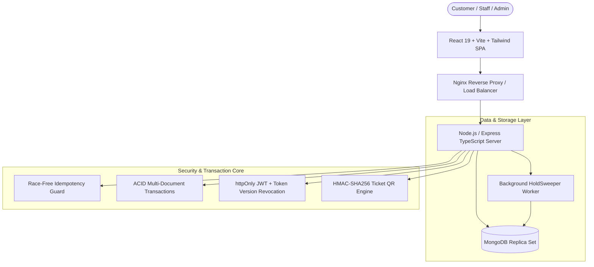

# Algions Cinema Hall Ticket Booking Engine

[](https://www.typescriptlang.org/)
[](https://nodejs.org/)
[](https://www.mongodb.com/)
[](https://react.dev/)
[](https://vitest.dev/)
[](http://localhost:5000/api/docs)

An enterprise-grade, high-concurrency cinema reservation platform engineered for real-time ticket sales. Features MongoDB replica set multi-document ACID transactions, atomic conditional seat holds, schedule overlap serialization via `Screen.scheduleVersion` locking, dual-expiry lazy evaluation, two-phase payment isolation, and HMAC-signed digital QR tickets.

---

## 🏛️ System Architecture



---

## ⚡ Key Engineering Invariants

1. **Zero Double-Bookings (Hardware-Enforced)**: Independent per-seat `ShowSeat` documents with compound unique index `(show, seatLabel)`. Concurrent writes target distinct documents in WiredTiger storage engine.
2. **Schedule Conflict Serialization**: Overcomes MongoDB's lack of range-exclusion constraints by atomic `$inc` on `Screen.scheduleVersion` inside the transaction, forcing write locks and enforcing 15-minute cleaning buffers.
3. **Dual Expiry**: Eager background sweeper (`HoldSweeper`) cleans stale holds every 30 seconds; lazy read evaluation dynamically treats `holdExpiresAt < now` as `AVAILABLE` so users never experience stale locks.
4. **Isolated Payment Gateway**: Third-party payment simulation runs **strictly outside** DB transactions to eliminate connection pool starvation.
5. **The "Paid But No Seat" Fallback Rule**: If a customer's hold expires while payment is in progress, the confirmation transaction marks the booking `EXPIRED` and sets `refundStatus = REFUND_PENDING` with an automated 100% refund.
6. **Payment Retries**: Non-unique index on `Payment { booking }` with partial unique index on `{ booking }` where `status = 'SUCCESS'`. Multiple failed attempts can exist, but exactly ONE success is allowed.
7. **Race-Free Idempotency**: Inserts `Idempotency-Key` with `status: IN_PROGRESS` upfront with SHA-256 payload hashing and `requestPath` binding. Losers fail with `409 Conflict`.
8. **Single-Use Ticket Admission**: Atomic `Ticket.findOneAndUpdate({ _id, status: 'VALID' }, { status: 'USED' })` prevents double-scan admission at auditorium doors.
9. **Zero Floating-Point Drift**: All currency amounts stored as integer minor units (paise) with price snapshots on every booking and ticket.

---

## 🧪 Acceptance Tests Verification Matrix

| # | Acceptance Test Criteria | Verification Test | Result |
|---|---|---|---|
| **1** | **Concurrency & Double-Booking**<br>Two users race for the exact same seat simultaneously. Exactly ONE succeeds; other gets 409 Conflict. | `holds.test.ts` (concurrent `Promise.all`) | **PASS** |
| **2** | **Dual Expiry**<br>Holds expire after 5 minutes. Seat automatically becomes available without manual intervention. | `holds.test.ts` & `seatmap.test.ts` | **PASS** |
| **3** | **Idempotent Checkout**<br>Replaying identical checkout request returns cached response without duplicate booking. | `bookings.test.ts` | **PASS** |
| **4** | **Single-Use Ticket Admission**<br>Scanning the same ticket QR code twice immediately rejects second attempt with 409 Conflict. | `tickets.test.ts` | **PASS** |
| **5** | **Occupancy & Cancellation Equation**<br>$\text{Occupancy} \equiv \text{Confirmed Bookings} - \text{Cancellations}$ | `reports.test.ts` | **PASS** |

---

## 🚀 Quickstart Guide

### Prerequisites
- **Node.js**: v20 or higher
- **npm**: v10 or higher
- **MongoDB**: Replica set enabled (local replica set or MongoDB Atlas M0 cluster)
- **Docker**: (Optional) For containerized execution

### 1. Installation & Environment Setup
```bash
# Clone repository
git clone https://github.com/Raman-8888/ALGIONS-AI-LABS.git
cd ALGIONS-AI-LABS

# Install all workspace dependencies
npm install

# Copy environment variables
cp .env.example .env
```

Ensure your `.env` contains a valid MongoDB Replica Set URI (required for ACID transactions):
```env
MONGODB_URI=mongodb+srv://<user>:<password>@cluster0.xxx.mongodb.net/cinema_db?retryWrites=true&w=majority
JWT_SECRET=super_secret_jwt_key_at_least_32_characters_long
HMAC_TICKET_SECRET=super_secret_hmac_ticket_key_at_least_32_chars
COOKIE_SECRET=super_secret_cookie_parser_signing_secret_key
PORT=5000
CLIENT_URL=http://localhost:5173
```

### 2. Database Seed
Populate default genres, movies, theatres, screens with seat layouts, scheduled shows, and demo users:
```bash
npm run seed
```

### 3. Run Development Servers
```bash
# Start backend API server (port 5000) & React frontend (port 5173) concurrently
npm run dev
```

- **Frontend Application**: `http://localhost:5173`
- **Backend API**: `http://localhost:5000/api/v1`
- **Interactive Swagger Documentation**: `http://localhost:5000/api/docs`

---

## 🐳 Docker Compose Deployment (3 API Replicas + Nginx Load Balancer)

To run the full production topology locally:
```bash
docker compose up --build
```
This spins up:
- 3 API Replicas (`api-1`, `api-2`, `api-3`)
- 1 Background Sweeper Worker (`worker`)
- 1 Nginx Load Balancer (round-robin proxy on port 80/443)
- 1 Local MongoDB 3-Node Replica Set (`mongo1`, `mongo2`, `mongo3`)

---

## 🔑 Demo Credentials

| Role | Email | Password | Permissions |
|---|---|---|---|
| **Admin** | `admin@cinema.com` | `Password@123` | Full CRUD for movies, theatres, screens, shows; reports; audit logs. |
| **Staff** | `staff@cinema.com` | `Password@123` | Single-use ticket admission validator scanner. |
| **Customer** | `customer@cinema.com` | `Password@123` | Public browsing, atomic seat holds, checkout, booking history, cancellation. |

---

## 📋 Running Automated Tests

The repository contains **59 automated tests** across 12 test suites:
```bash
# Run entire test suite (Server + Client)
npm test

# Run Server tests only (in-memory replica set with MongoMemoryReplSet)
npm run test:server

# Run Client tests only (Vitest + React Testing Library)
npm run test:client
```

---

## 📖 Documentation & Architecture References

- **[Technical Report](docs/technical-report.md)**: Deep dive into data modeling, WiredTiger concurrency, transactions, and Tier 3 scale roadmap.
- **[Architecture Reference Guide](docs/architecture-reference.md)**: Exhaustive module specifications, schema invariants, and state machines.
- **[Entity Relationship Diagram](docs/er-diagram.md)**: Mermaid diagram detailing all 12 MongoDB collections and composite indexes.
- **[Load Testing Benchmarks](loadtest/results.md)**: k6 race-condition and mixed-traffic concurrency results.
- **[Demo Video Script](docs/demo-script.md)**: Step-by-step walkthrough script for the 5 acceptance tests.
- **[OpenAPI 3.0 Specification](docs/openapi.yaml)**: OpenAPI spec served live at `/api/docs`.
- **[Known Limitations](KNOWN_LIMITATIONS.md)**: Explicit record of intentional scope boundaries and mitigations.
- **[AI Usage & Attribution](AI_USAGE.md)**: Log of AI assistance and human review across all phases.
