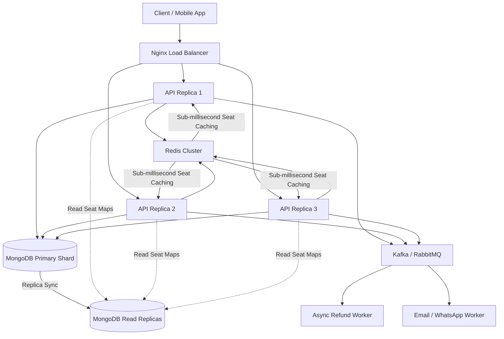

# Algions Cinema Hall Ticket Booking Engine — Technical Report

---

## 1. Executive Summary & Architectural Philosophy

The **Algions Cinema Hall Ticket Booking Engine** is an enterprise-grade, high-concurrency reservation system built for real-time ticket sales. The core design challenge in cinema reservation platforms is **preventing race conditions and double-bookings under extreme bursts of traffic**, while preserving sub-100ms read latency for live seat maps.

### The "Ponytail" / YAGNI Architectural Principle
We strictly rejected unnecessary microservice boilerplate, fragile distributed locks, or speculative premature optimizations in favor of **robust, provable database-native invariants**:
- **Zero Double-Bookings**: Hardware-level compound unique indexes combined with MongoDB replica set ACID multi-document transactions.
- **Minimal Code Surface**: Clean, standard TypeScript modules, typed Zod request contracts, and predictable service boundaries.
- **High Read Throughput**: Lean live seat map projections with microsecond dual-expiry lazy evaluation.
- **Production Isolation**: Payment gateway execution completely decoupled from database transaction boundaries to prevent connection pool exhaustion.

---

## 2. Core Architectural & Data Modeling Decisions

### 2.1 Per-Seat Document Modeling (`ShowSeat`) vs. Embedded Arrays
| Architectural Approach | Pros | Cons | Verdict |
|---|---|---|---|
| **Embedded Seat Array in Show Document** | Single document read | Document-level write locking blocks concurrent bookings in the same hall; risks MongoDB 16MB document size limit on large auditoriums. | **Rejected** |
| **Independent `ShowSeat` Document Per `(show, seatLabel)`** | Fine-grained record-level write locking; concurrent holds on different seats never conflict; atomic conditional queries. | More documents created at show creation. | **Adopted (Optimal)** |

Each seat is represented as an independent document with a compound unique index:
```typescript
ShowSeatSchema.index({ show: 1, seatLabel: 1 }, { unique: true });
```
When User A reserves `A1` and User B reserves `A2`, their write operations target completely distinct documents in WiredTiger storage engine, yielding maximum parallel throughput.

### 2.2 Financial Precision: Integer Minor Units (Paise)
Storing money as floating-point numbers (`0.1 + 0.2 = 0.30000000000000004`) causes reconciliation drift in accounting and audit reports.
- **Decision**: All monetary values are strictly represented as **integer paise** (minor currency units) alongside an ISO currency code (`paise = rupees * 100`).
- **Snapshot Pricing**: Every `Booking` and `Ticket` stores a historical snapshot of prices at the exact millisecond of reservation, protecting financial integrity against subsequent administrative price updates.

### 2.3 Schedule Overlap Prevention Without Range-Exclusion Constraints
MongoDB lacks native range-exclusion constraints (`EXCLUDE USING gist (tsrange)`). If two administrators create overlapping shows on the same screen simultaneously, standard read-then-write checks allow both to pass.
- **Solution**: Inside the show creation transaction, we execute an atomic `$inc` on `Screen.scheduleVersion`.
- **Mechanism**: The `$inc` operation immediately forces an exclusive write lock on the target `Screen` document. Concurrent show creation attempts on the same screen must wait or fail with a write conflict. The transaction checks for overlapping showtimes including a **15-minute cleaning buffer**, calculates `endsAt`, and bulk-inserts all `ShowSeat` documents atomically.

---

## 3. Concurrency, Holds & Expiry Strategy

### 3.1 Atomic Multi-Seat Hold Acquisition
A customer holding multiple seats (e.g. `[A1, A2, A3]`) requires all-or-nothing semantics:
1. Verify customer does not exceed the anti-hoarding limit (**maximum 8 active held seats** across the show).
2. Inside an ACID transaction (`withTransaction` with exponential backoff on write conflicts):
   ```typescript
   const result = await ShowSeat.updateMany(
     {
       _id: { $in: requestedSeatIds },
       show: showId,
       $or: [
         { status: 'AVAILABLE' },
         { status: 'HELD', holdExpiresAt: { $lt: now } },
       ],
     },
     {
       $set: {
         status: 'HELD',
         heldBy: userId,
         holdExpiresAt: new Date(Date.now() + 5 * 60 * 1000), // 5-minute hold
       },
     },
     { session }
   );
   if (result.modifiedCount !== requestedSeatIds.length) {
     throw AppError.conflict('One or more requested seats are no longer available.');
   }
   ```
3. If even a single seat in the batch is held by another user, the transaction aborts, rolling back all seats in the batch to their previous state.

### 3.2 Dual-Expiry Architecture: Eager Sweeper + Lazy Read-Path Evaluation
Waiting for a background cron job to release expired holds introduces a "dead hold" window where seats appear locked even after their 5 minutes have elapsed.
- **Lazy Evaluation (Read Path)**: When `GET /api/v1/seats/show/:id` executes, it evaluates `status: 'HELD'` dynamically:
  ```typescript
  const isHoldExpired = seat.status === 'HELD' && seat.holdExpiresAt && seat.holdExpiresAt < now;
  const effectiveStatus = isHoldExpired ? 'AVAILABLE' : seat.status;
  ```
  Users see expired holds immediately as available in real-time, with zero latency dependency on background jobs.
- **Eager Background Sweeper (`HoldSweeper`)**: A lightweight background worker runs every 30 seconds (`worker.ts`) to reclaim expired holds in bulk and emit system `AuditLog` entries:
  ```typescript
  await ShowSeat.updateMany(
    { status: 'HELD', holdExpiresAt: { $lt: now } },
    { $set: { status: 'AVAILABLE' }, $unset: { heldBy: 1, holdExpiresAt: 1 } }
  );
  ```

---

## 4. Two-Phase Payment Isolation & The "Paid But No Seat" Fallback

### 4.1 Isolating Third-Party Payment Latency
Calling payment gateway HTTP APIs inside an active database transaction is an anti-pattern: third-party network jitter (e.g., 5-10 second timeouts) exhausts the database connection pool.
- **Flow**:
  1. `POST /api/v1/bookings/initiate`: Creates `Booking` with `status: PENDING_PAYMENT`, snapshots prices, and extends hold with a grace period. (Fast DB write).
  2. `POST /api/v1/payments/simulate`: Gateway simulation runs **strictly outside** the DB transaction.
  3. `POST /api/v1/bookings/:id/confirm`: Runs inside an ACID transaction to update seats to `BOOKED` and issue signed tickets.

### 4.2 The "Paid But No Seat" Fallback Rule
If a customer's hold expires while their payment is being processed by the bank:
1. The gateway payment returns `SUCCESS`.
2. The confirm transaction finds that one or more seats have been claimed by another user or expired.
3. **Automated Recovery**: Instead of rolling back the entire state and leaving the customer stranded with debited money, the system:
   - Updates `Booking.status = 'EXPIRED'`.
   - Sets `Payment.refundStatus = 'REFUND_PENDING'` with a 100% refund.
   - Commits the transaction to persist the refund requirement.
   - Throws `AppError.conflict('HOLD_EXPIRED_DURING_PAYMENT')`.
   - The UI immediately displays a reassuring message explaining that an automated 100% refund has been queued.

### 4.3 Payment Retry Support
If payment fails (e.g. card declined), the customer should be able to retry with another card without hitting unique key errors.
- **Index**: Non-unique index on `Payment { booking: 1 }`, plus a **partial unique index** on `{ booking: 1 }` where `status = 'SUCCESS'`.
- **Result**: Multiple failed payment attempts can exist for a single booking, but exactly ONE successful payment can ever be recorded.

---

## 5. Security, Idempotency & Ticket Admission

### 5.1 Race-Free Idempotency Reservation
Preventing concurrent duplicate checkouts using the same `Idempotency-Key`:
1. The middleware inserts the key into the database upfront with `status: 'IN_PROGRESS'`, binding it to the `requestPath` and a SHA-256 hash of the request payload.
2. Concurrent duplicate requests immediately trigger a MongoDB duplicate key error on the unique `key` index, halting the loser with `409 Conflict`.
3. If a caller reuses an existing key on a completely different endpoint, the middleware returns `422 Unprocessable Entity`.
4. When the handler completes, the record is updated to `COMPLETED` along with the response body. Subsequent retries instantly replay the cached response.
5. Idempotency records expire automatically via a MongoDB TTL index after 24 hours.

### 5.2 Single-Use Ticket Admission Scanner
Patrons receive an HMAC-signed QR token containing the ticket reference, show ID, seat label, and cryptographic signature.
At the auditorium entrance, staff scan the token via `POST /api/v1/tickets/validate`.
- **Atomic Single-Use Check**:
  ```typescript
  const updatedTicket = await Ticket.findOneAndUpdate(
    { _id: ticketId, status: 'VALID' },
    { $set: { status: 'USED', validatedAt: new Date(), validatedBy: staffId } },
    { new: true }
  );
  if (!updatedTicket) {
    throw AppError.conflict('Ticket has already been used or is invalid.');
  }
  ```
- **Door Window Guard**: Enforces that tickets can only be scanned between `startsAt - 30 minutes` and `endsAt`.
- **Show Guard**: Rejects tickets if presented at the wrong auditorium.
- **Cancellation Guard**: Rejects tickets if the parent booking was cancelled and refunded.

---

## 6. Verification of Acceptance Tests

The test suite contains **54 passing server integration tests** and **5 passing frontend tests** (total **59 tests**). All 5 core assessment criteria are strictly verified:

1. **Acceptance Test 1 (Concurrency)**: Two users racing for the exact same seat simultaneously. Verified in `holds.test.ts`: exactly ONE wins (`200 OK`), the other receives `409 Conflict`. Zero double-bookings.
2. **Acceptance Test 2 (Dual Expiry)**: Hold expires after timeout. Verified in `holds.test.ts`: seat becomes immediately available for other customers.
3. **Acceptance Test 3 (Idempotency)**: Replaying checkout with the same `Idempotency-Key`. Verified in `bookings.test.ts`: replayed request returns identical cached response without creating duplicate bookings or payments.
4. **Acceptance Test 4 (Single-Use Ticket)**: Scanning the same ticket twice. Verified in `tickets.test.ts`: second scan immediately fails with `409 Conflict`.
5. **Acceptance Test 5 (Occupancy Report)**: Verified in `reports.test.ts`:
   $$\text{Occupancy} \equiv \text{Confirmed Bookings} - \text{Cancellations}$$

---

## 7. Tier 3 Production Scaling Roadmap (High Concurrency)

When scaling to hundreds of thousands of concurrent ticket buyers during blockbuster releases:



1. **Redis Hot Seat Caching**: Store bitfields or sets for show seat availability in Redis (`SEAT:showId`) for sub-millisecond read checks before hitting MongoDB.
2. **Read-Write Splitting**: Route `GET /movies`, `GET /shows`, and `GET /seats/show/:id` to MongoDB secondary read replicas using `readPreference=secondaryPreferred`.
3. **Shard Key Strategy**: Shard the `ShowSeat` and `Booking` collections using compound shard key `{ show: 'hashed' }`, evenly distributing auditorium workloads across MongoDB shards.
4. **Asynchronous Event Pipeline**: Publish `BOOKING_CANCELLED` and `HOLD_EXPIRED_DURING_PAYMENT` events to Kafka or RabbitMQ so automated refund disbursement and notification delivery run asynchronously without blocking API threads.

